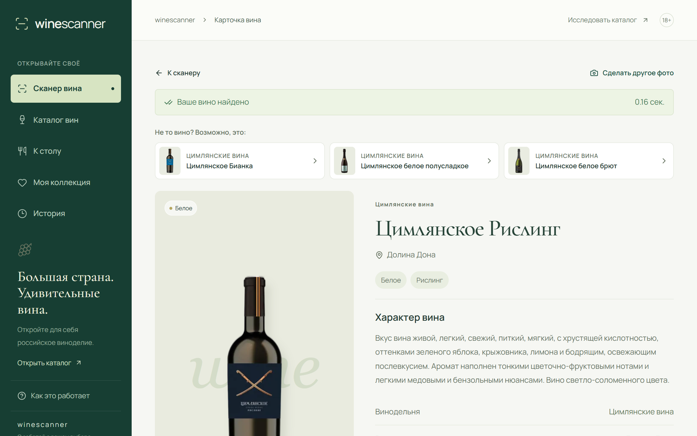
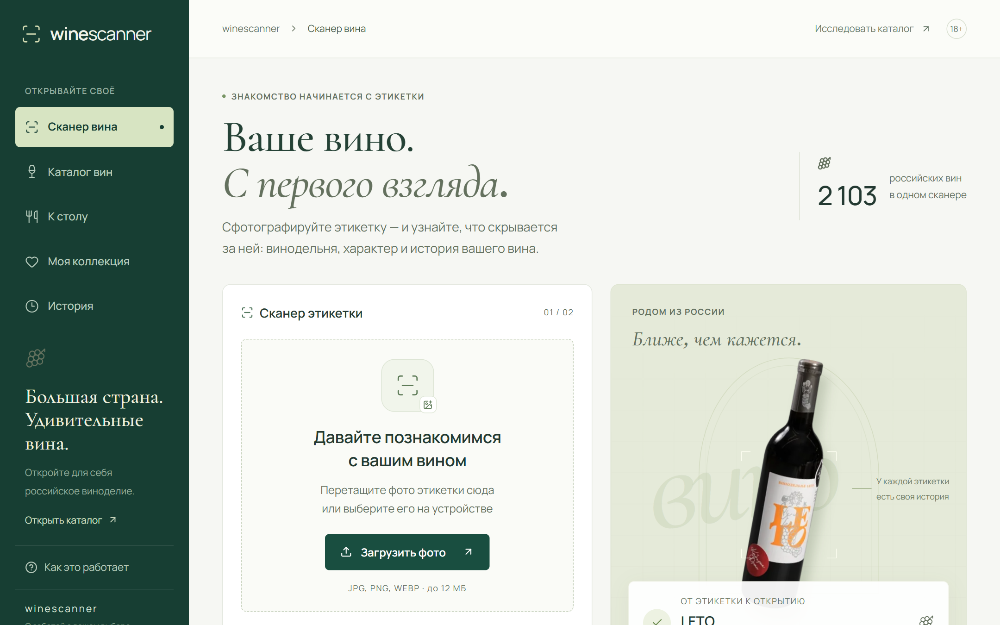
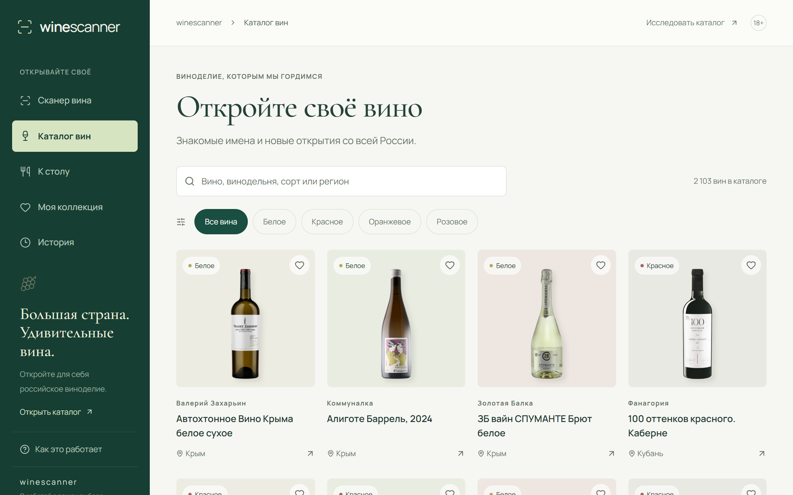
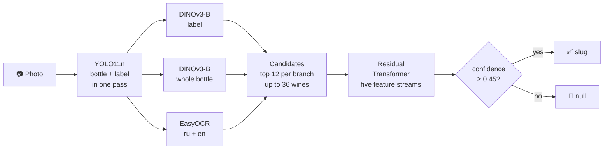

**Language:** [Русский](README.md) · English

<div align="center">

# 🍷 winescanner

**Take a photo of a label and discover the wine.**<br>
A scanner for Russian wines: 2,103 wines from the Svoe Vino catalog, results in a fraction of a second,<br>
an honest “I don't know” for wines outside the catalog, and a sommelier to help pair wine with dinner.

[](https://github.com/melnikovknst/VIscaNEr/actions/workflows/ci.yml)




</div>

---

## 🚀 Run with one command

On Ubuntu 22.04 / 24.04, you only need `git` and `sudo`:

```bash
git clone https://github.com/melnikovknst/VIscaNEr.git && cd VIscaNEr && ./run.sh
```

`run.sh` will:

1. install Docker and Git LFS if needed;
2. download the model weights and catalog (~1 GB);
3. build the image for **GPU** if an NVIDIA GPU with NVIDIA Container Toolkit is available, or **CPU** otherwise;
4. wait for the models to load and print the service URLs.

The first launch takes 5–10 minutes to build the image; subsequent launches take seconds.

| Service | URL |
|---|---|
| Website | http://127.0.0.1:8080 |
| Evaluation endpoint | `POST http://127.0.0.1:8080/v1/eval/predict` |
| API documentation (Swagger) | http://127.0.0.1:8080/docs |

```bash
./run.sh logs     # show logs
./run.sh stop     # stop the service
./run.sh --cpu    # force CPU mode
```

## 🧪 Test with the organizers' script

The service accepts a photo in the multipart field `image` and returns the top-1 wine `slug`:

```bash
curl -F image=@photo.jpg http://127.0.0.1:8080/v1/eval/predict
# {"slug":"czimlyanskoe-risling"}
```

If the wine is not in the catalog or the model is uncertain, it returns `{"slug":null}` instead of guessing.

```bash
./participant_test.sh \
  --images-dir ./queries \
  --manifest ./queries.tsv \
  --endpoint 'http://127.0.0.1:8080/v1/eval/predict' \
  --output ./predictions.jsonl
```

Requests are processed one at a time: 0.1–0.4 seconds per photo on an RTX 5070. The service also runs on CPU, but more slowly.

## ✨ Features

<table>
<tr>
<td width="50%"></td>
<td width="50%"></td>
</tr>
</table>

- **Label scanner:** upload a photo or use a phone camera. You can photograph wines on a store shelf; the scanner selects the bottle near the center of the frame.
- **Honest answers:** a confidently recognized wine opens directly. If several labels look similar, the site offers candidates rather than presenting a guess as a fact.
- **Catalog:** 2,103 wines searchable by name, winery, grape variety, and region.
- **Food pairing:** with the sommelier enabled, a language model explains recommendations using only catalog data; otherwise, editorial pairing rules are used.
- **Collection and scan history:** stored in the visitor's browser, with no account required.

## 🧠 How it works



1. **Detector:** a YOLO11n model fine-tuned on annotated shelf photos finds bottles and labels in one pass. It selects the target using detection confidence and a bonus for proximity to the frame's vertical center, where the user is likely aiming the camera.
2. **Two DINOv3-B/16 encoders:** fine-tuned for catalog retrieval. One compares the label with reference catalog labels; the other compares the whole bottle, including shape, glass color, and capsule.
3. **EasyOCR:** reads the label text; character n-grams are compared with wine names.
4. Each branch proposes its 12 nearest wines. A **residual Transformer** reranks the combined pool of up to 36 candidates using all five feature streams for the query and candidates, learning to correct mistakes made by individual branches.
5. **Confidence:** softmax over the logits of the top 10 candidates. Below the 0.45 threshold, the service returns `null`.

For details, weight formats, and the rationale for the threshold, see [docs/ARCHITECTURE.md](docs/ARCHITECTURE.md) (in Russian).

## ⚙️ Configuration

On the first run, `run.sh` creates `.env` from [.env.example](.env.example). Restart `./run.sh` after making changes.

| Variable | Default | Purpose |
|---|---|---|
| `PORT` | `8080` | Website and API port |
| `VISCANER_DEVICE` | `auto` | `auto`, `cuda`, or `cpu` |
| `VISCANER_MIN_CONFIDENCE` | `0.45` | Below this, `/v1/eval/predict` returns `null` |
| `VISCANER_MIN_SUGGEST_CONFIDENCE` | `0.20` | Below this, the site does not suggest candidates |
| `VISCANER_SOMMELIER_ENABLED` | `false` | Enable the language-model sommelier |
| `VISCANER_OPENROUTER_API_KEY` | — | [OpenRouter](https://openrouter.ai/keys) key for the sommelier |
| `VISCANER_OPENROUTER_MODEL` | `anthropic/claude-sonnet-5.5` | Any OpenRouter chat model |

The sommelier is off by default because it requires an API key and internet access. When enabled, the food-pairing tab and wine cards get a chat that selects wines from the catalog and explains its choices. Catalog search (bge-m3) runs locally; only answer generation uses the external API.

## 🗂 Repository structure

```text
├── run.sh                    one-command launch
├── Dockerfile, compose*.yaml build: React frontend + FastAPI + models in one image
├── backend/                  FastAPI: scanning, catalog, history, sommelier, food pairing
├── five_stream_transformer/  inference: DINOv3 encoders, OCR features, Transformer
├── joint_yolo/               bottle and label detector, target selection
├── frontend/                 React + TypeScript + Vite
├── models/                   weights (Git LFS, ~0.9 GB), descriptions, SHA-256 hashes
├── data/                     catalog, reference galleries, wine profiles for the sommelier
└── docs/                     architecture and screenshots
```

## 🛠 Development without Docker

```bash
python3 -m venv .venv && source .venv/bin/activate
pip install torch==2.11.0 torchvision==0.26.0 --index-url https://download.pytorch.org/whl/cu128
pip install -r requirements.txt pytest
npm ci && npm run build          # frontend is built into dist/ and served by the same server
uvicorn backend.main:app --port 8080
```

`npm run dev` starts the frontend with hot reload on :5173 and the API on :8000.
Run tests with `pytest backend five_stream_transformer joint_yolo`.

## 🔬 Research history

Model training, data annotation, Kaggle notebooks, datasets, and intermediate experiments (cascades, bottle classifiers, fusion MLPs) are in the [`development`](https://github.com/melnikovknst/VIscaNEr/tree/development) branch.

---

<div align="center">
Svoe Vino challenge · RSHB.Digital · LCT 2026 · <a href="LICENSE">MIT</a>
</div>
